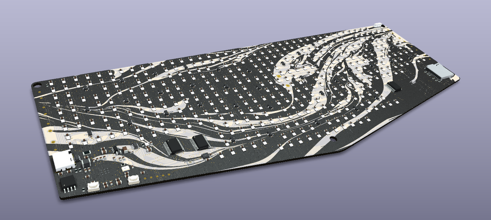
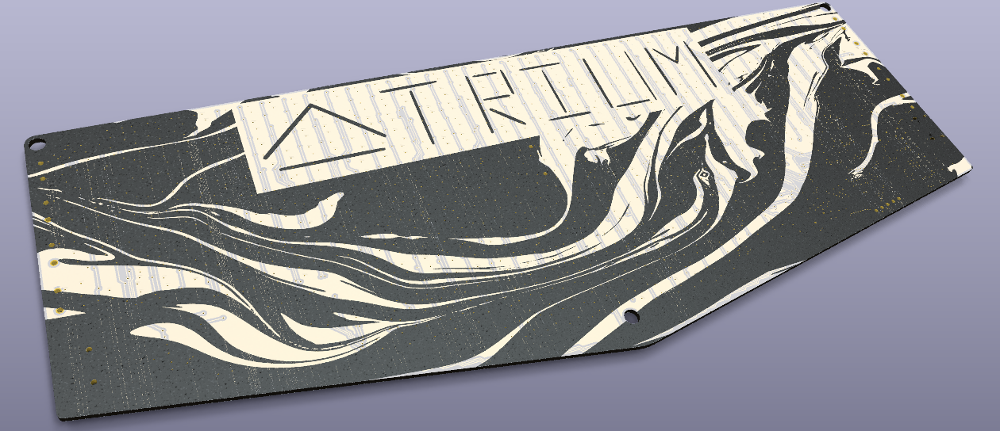
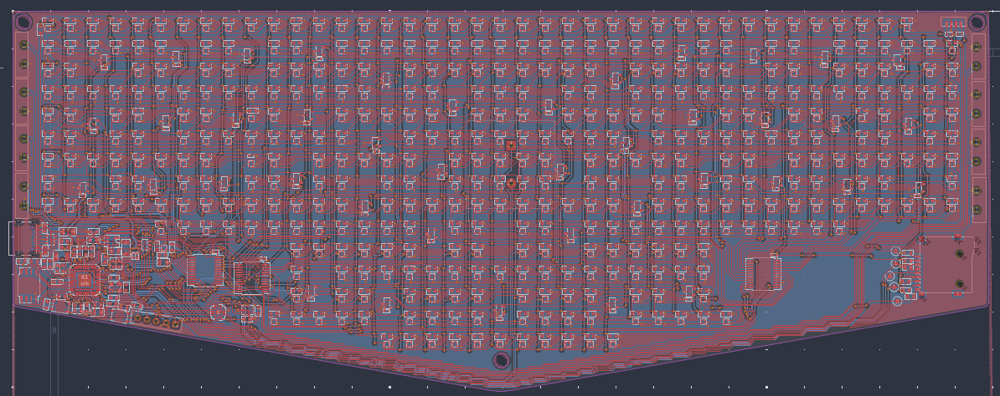
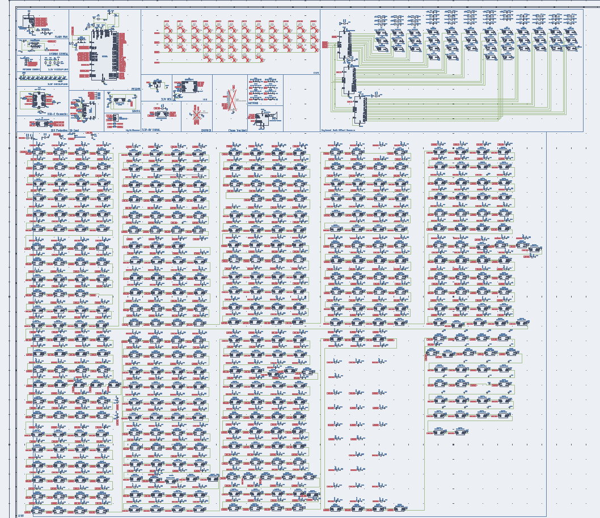

# Atrium
The weirdest keyboard you've seen

## 3D Model Preview

## 3D PCB Preview

## Wiring

## Schematic

## Introduction
Most keyboards are functional, but a little boring. They dont have much complexity, and for as much space as it takes up on your desktop, I think it deserves more attention. So naturally, this led me a rabbit hole of finding the most outrageously useless (or useful depending on how you see it) features to a keyboard while still keeping it useable. This culminated into Atrium, a compact 40% ergonomic transparent keyboard with a full background RGB LED display, accelerometer, a speaker (idk why youd need this honestly), 8 external buttons (also dont really have a complete use for this, maybe for a funny looking gaming console?), and an sd card reader. The keyboard is all based on a single 2 layer pcb which can be fabricated through a service like JLCPCB.

The background display is the critical component of the keyboard, I imagine it looking really cool for fluid and boid simulations. However, the size restraints of the display for a decently acceptable level of resolution meant that I couldn't use regular key switches. To make this work the pcb has hall effect sensors below each magnetic switch to detect the changing magnetic field and then register a press. All of these switches are mounted on a piece of plexiglass above the pcb itself.

## Bill of Materials 

| Quantity | Components | Price | Link |
|--------- |----------|----------| -----|

| 2 | 200x300x3mm Plexiglass sheet | $20 | [here](https://www.aliexpress.us/item/3256807722386926.html?spm=a2g0o.productlist.main.2.39f129e2SERr2S&algo_pvid=185f7068-e484-4aa3-9ff3-0e65a2acbd56&algo_exp_id=185f7068-e484-4aa3-9ff3-0e65a2acbd56-1&pdp_ext_f=%7B%22order%22%3A%22156%22%2C%22eval%22%3A%221%22%2C%22fromPage%22%3A%22search%22%7D&pdp_npi=6%40dis%21USD%218.44%215.23%21%21%2156.35%2134.94%21%402101c4ea17891631287926600e102c%2112000042797704390%21sea%21US%217493938711%21X%211%210%21n_tag%3A-29919%3Bd%3Ad260408f%3Bm03_new_user%3A-29895&curPageLogUid=IFVzF4QWo7zW&utparam-url=scene%3Asearch%7Cquery_from%3A%7Cx_object_id%3A1005007908701678%7C_p_origin_prod%3A)
| 40 | Cherry MX size (14mm) Magnetic Switches | $35 |[here](https://www.amazon.com/KPREPUBLIC-Ice-Magnetic-Ultra-Switch/dp/B0F2TCCYWP?crid=I18TQ6WCZ55V&dib=eyJ2IjoiMSJ9.78J6AGarRQEMe0vTq8MGYLsxi-S4JBDiDRFAosFVx6_VF4t3cJ96uidIVCECAGzF25KllPLyLHb92NJ_lEqfo1-gvFnc_Fb6D9Iair7aUHSxG23V4wG2haL1KBqHgXqXCmF1R7FXjrgNCZcwF3E_cyp0AIlmCZVgh__9aZx_8NhSv6mvjCwJ1vqvtoQLOhn_J3bUNSnNhFdLBvh5NzHbx5Rjh5HcFxqc6zd1yXfZoDY.UsFUvTRnK5RhONAHTDqrIzdRvolbcLwU5a02U6N0Xw4&dib_tag=se&keywords=transparent%2Bhall%2Beffect%2Bswitches&qid=1791690004&sprefix=transparenthall%2Beffect%2Bswitches%2Caps%2C330&sr=8-1&th=1) 
| 3 | M4 bolts and nuts | $12 | [here](https://www.aliexpress.us/item/3256807092650644.html?spm=a2g0o.productlist.main.1.675a7aa5twLngJ&algo_pvid=d4270fee-9c36-4b22-9c88-86ae13a58121&algo_exp_id=d4270fee-9c36-4b22-9c88-86ae13a58121-0&pdp_ext_f=%7B%22order%22%3A%229119%22%2C%22eval%22%3A%221%22%2C%22fromPage%22%3A%22search%22%7D&pdp_npi=6%40dis%21USD%215.26%215.26%21%21%2135.03%2135.03%21%402101ca9517916959045395475e12b4%2112000040076085093%21sea%21US%217493938711%21X%211%210%21n_tag%3A-29919%3Bd%3Ad260408f%3Bm03_new_user%3A-29895&curPageLogUid=tqNMsgS5ewqS&utparam-url=scene%3Asearch%7Cquery_from%3A%7Cx_object_id%3A1005007278965396%7C_p_origin_prod%3A) 
| 1 | PCBA for Atrium (comes with 2) | $250 | Upload PCB fabrication files to JLCPCB.   

Total cost: **$**

Cost per pen: **$**

----

## Tools / Other parts:
- 

## Assembly
1. Cut the plexiglass sheets to the correct shapes (print a small cutout to help)
2. Flash firmware onto the Atrium pcb
3. Assemble together with bolts and spacers
4. Add felt or rubber pads to the feet at the 5 corners